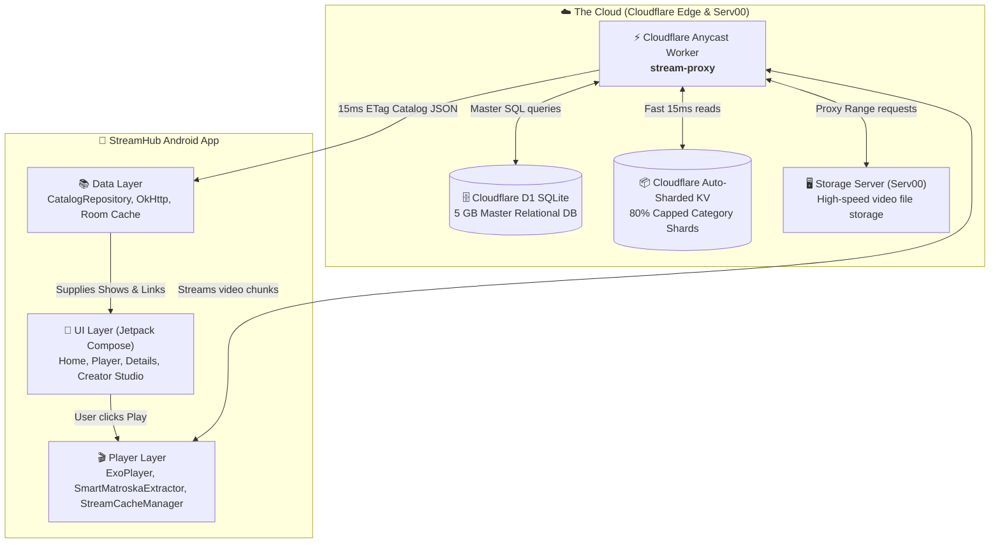
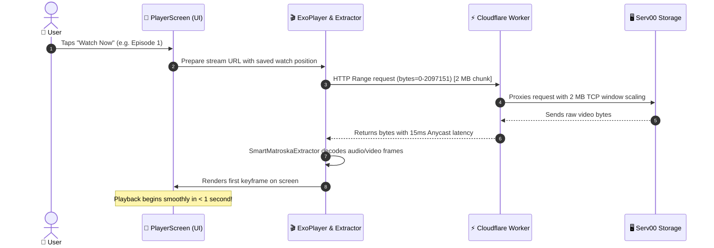

# 🏛️ StreamHub Master Architecture & System Blueprint

Welcome to the architectural blueprint of **StreamHub** — an ultra-high-performance, zero-cost Android media streaming ecosystem built with Kotlin, Jetpack Compose, Media3 (ExoPlayer), and Cloudflare Edge Workers.

This document is written in **plain English** so that anyone — whether you are an experienced software architect, an open-source contributor, or someone reading code for the very first time — can easily understand how StreamHub works from top to bottom.

---

## 🗺️ High-Level System Overview

At the highest level, StreamHub operates like a modern cinema on your phone:



---

## 🧱 The 3 Pillars of the Android App

StreamHub follows a strict **Layer Separation** architecture. Each layer has one dedicated responsibility and never interferes with the others:

```
app/src/main/java/com/streamhub/app/
│
├── 📚 data/          # THE LIBRARY: Fetches, caches, and organizes information
├── 🎬 player/        # THE PROJECTOR: Streams, demuxes, decodes, and buffers video
└── 🎨 ui/            # THE SCREEN: Draws what you see and handles your touches
```

### 1. 📚 The Data Layer (`app/.../data/`)
- **What it is**: The librarian of the app.
- **What it does**: 
  - Talks to the Cloudflare Edge Worker to fetch the list of 554+ movies, anime, and series.
  - Checks if the catalog has updated using fast **HTTP 304 ETag validation** (~15ms response).
  - Caches the entire catalog on disk so the app opens instantly even when offline.
  - Stores your watch history, saved bookmarks ("My List"), and single-device VIP vouchers.
- **Rule**: Never touches or imports UI layouts (`androidx.compose.*`).

### 2. 🎬 The Player Layer (`app/.../player/`)
- **What it is**: The high-performance streaming engine.
- **What it does**:
  - Powers video playback using AndroidX Media3 (ExoPlayer).
  - Uses `SmartMatroskaExtractor` to decode MKV video files and resolve seek indexes (Cues) instantly with zero frame drops.
  - Features **2 MB TCP window scaling** via `HighThroughputSocketFactory`, allowing 2.5–4.8 MB/s streaming over high-latency international routes.
  - Automatically manages multi-gigabyte disk and RAM caches (`StreamCacheManager`), purging watched chunks and retaining forward buffer runway.
- **Rule**: Strictly bound to `player.playWhenReady` for zero play/pause state inversion.

### 3. 🎨 The UI Layer (`app/.../ui/`)
- **What it is**: The presentation layer built with 100% Jetpack Compose (Material 3).
- **What it does**:
  - Draws the Home Screen, Video Player HUD, Details Screen, Creator Studio, and Settings.
  - Runs with 120fps fluid spring animations and adaptive edge-to-edge layouts.
  - Purely reacts to immutable UI state flows (`StateFlow<T>`) emitted by ViewModels.

---

## 📱 Feature-by-Feature Screen Map

Each screen in StreamHub is organized into its own dedicated package for maximum modularity and clarity:

| Feature / Screen | Package Location | What It Does in Plain English |
| :--- | :--- | :--- |
| **🏠 Home Screen** | `ui/screens/home/` | Displays the sliding hero banner, category filter pills (ALL, MOVIES, ANIME, SERIES), and horizontal scrolling shelves (Trending, Anime, Blockbusters). Saves your scroll position permanently. |
| **🎬 Video Player** | `ui/screens/player/` | Full-screen video player with swipe controls (brightness, volume, 200% voice boost), chapter seekbar, picture-in-picture, audio/subtitle switcher, and Stats for Nerds. |
| **🍿 Details Screen** | `ui/screens/details/` | Show information page: backdrop banner, synopsis, cast voice actors, seasons, episodes, and franchise chronological timeline shelf. |
| **📑 My List Screen** | `ui/screens/mylist/` | Bookmarked catalog hub: personalized collections, category filters, completion badges, and instant resume points. |
| **📥 Downloads** | `ui/screens/downloads/` | High-throughput offline media downloader with batch episode selection, paused/resumed queue, and disk management. |
| **🔍 Search Screen** | `ui/screens/search/` | Instant real-time search across titles, genres, studios, and actors with filter chips and search history. |
| **📢 Broadcast Announcements** | `ui/screens/broadcast/` | Global push notifications and in-app system banner alerts management studio for admins and creators. |
| **💾 Storage & Cache** | `ui/screens/storage/` | Real-time storage gauge (downloads, ExoPlayer video stream cache, Coil image cache), granular cleaner, and cache retention policies. |
| **🕒 Watch History** | `ui/screens/history/` | Chronological viewing history with progress indicator bars, instant resume playback, and batch/individual clear tools. |
| **👤 Profile & Pulse** | `ui/screens/profile/` | Personal Hub: user avatar customization (20 original illustrated presets or custom photo), viewing analytics (hours, streak, Taste DNA), admin unlock, and member ID. |
| **⚙️ Settings & Preferences** | `ui/screens/settings/` | mpvEx-parity settings hub: video buffer preferences, subtitle typography customization (colors, fonts, sizes), 7 theme accents (AMOLED black), gestures, and audio boost. |
| **ℹ️ About StreamHub** | `ui/screens/about/` | Application credits, high-performance ExoPlayer architecture details, ARM64 build diagnostics, and official Telegram bot / GitHub repository links. |
| **✨ Splash Screen** | `ui/screens/splash/` | 120fps opening animation with animated SVG waveforms, ambient radial neon glow, and warm catalog pre-read gate. |

---

## ⚡ How Video Streaming Works (The Journey of a Video Chunk)

When you tap on any movie or episode, here is the exact journey data takes in under 1 second:



---

## 🔒 Security & Privacy Guarantees

StreamHub is designed so that the public open-source repository can be browsed safely by anyone without compromising production security:

1. **Zero Secrets in Code**: All API keys, master passwords, and release keystores live strictly in GitHub Secrets and local uncommitted `local.properties`.
2. **Bytecode Scrambling (R8 Minification)**: Production APKs are minified and obfuscated with R8, scrambling classes and variables into unreadable identifiers.
3. **Debug Logs Stripped**: All `Log.d`, `Log.v`, and `Log.i` statements are erased from bytecode during compilation, preventing stream URLs or device IDs from leaking.
4. **Cloudflare Edge Write Protection**: All database modification endpoints (`PUT`, `DELETE`, `POST`) require secret Admin Password authorization at the Cloudflare edge.
5. **Hardware-Locked VIP Vouchers**: VIP codes are cryptographically bound to the user's device hardware hash, preventing code sharing across multiple devices.

---

## 📖 Glossary for Beginners

- **ExoPlayer / Media3**: Google's official media playback library for Android.
- **Jetpack Compose**: Android's modern declarative UI toolkit (writing UI with Kotlin functions instead of old XML files).
- **Cloudflare Worker**: A serverless program running across 300+ edge data centers with 10–15ms response times.
- **Cloudflare D1**: Serverless relational SQLite database (5 GB storage) acting as the permanent master source of truth.
- **Cloudflare KV**: High-speed edge cache holding category-sharded catalog snapshots capped at 80% (20 MB) with zero truncation risk.
- **Matroska / MKV**: A flexible video container file format that can hold multiple audio languages, subtitles, and chapter markers in a single file.
- **Cues Index**: An internal index at the end of an MKV file that tells the player where each timestamp lives in bytes, enabling instant seeking.
- **ETag / HTTP 304**: A smart web caching system. If the catalog hasn't changed since your last visit, Cloudflare says *"304 Not Modified"* and sends 0 bytes, saving battery and data.
