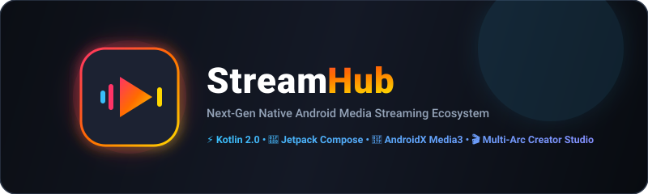
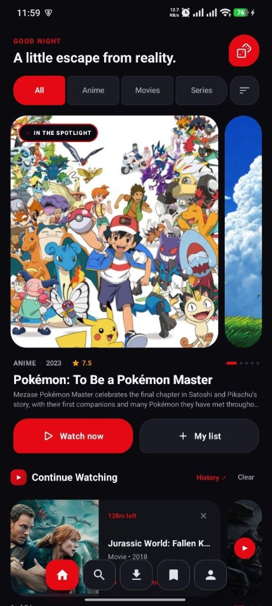
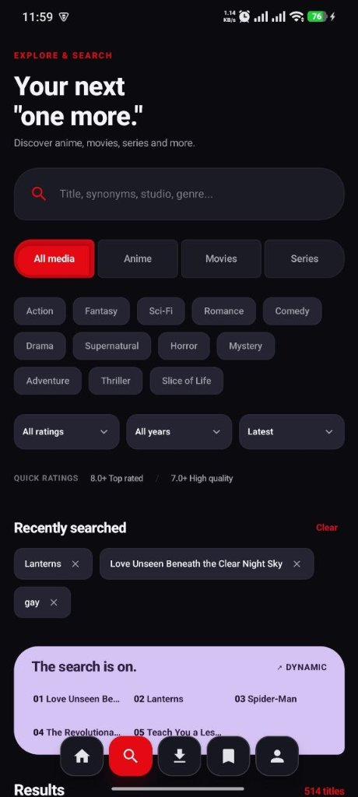
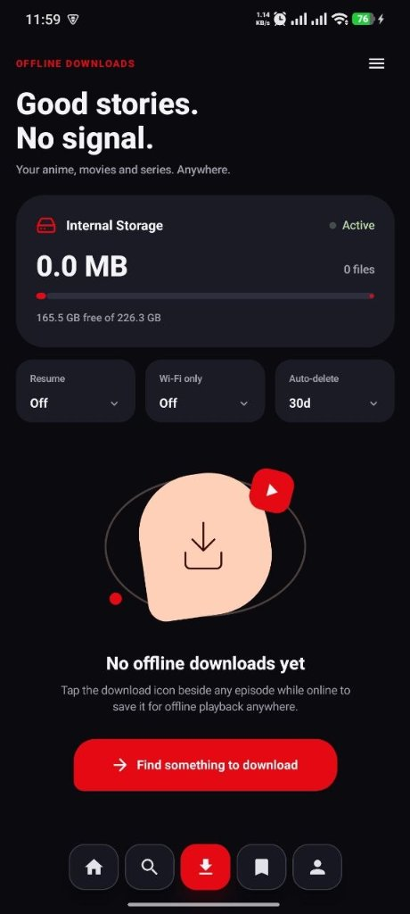
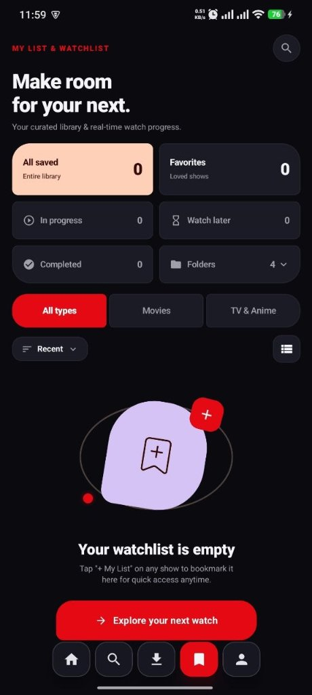
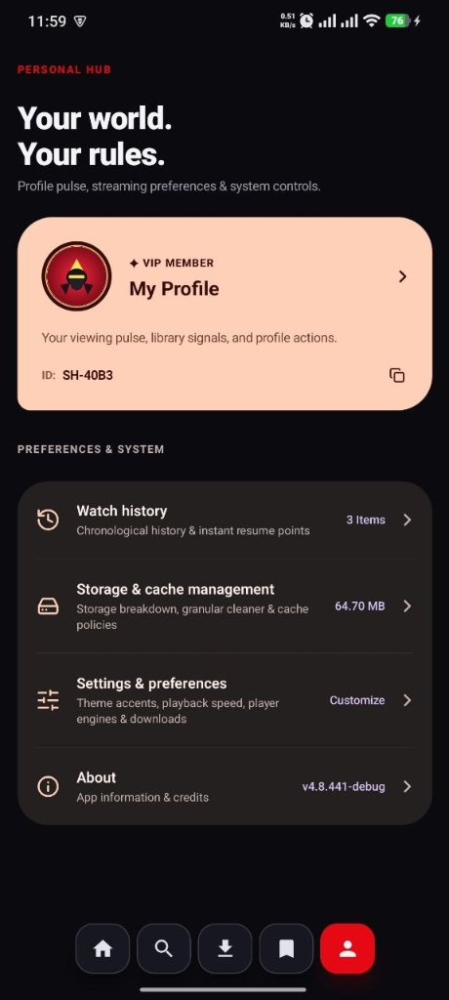
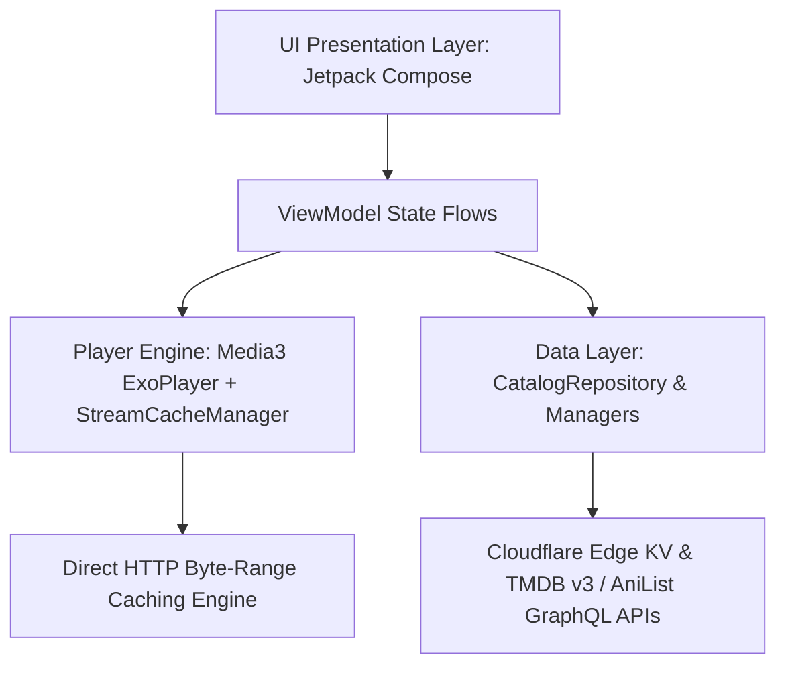

<p align="center">
  
</p>

<p align="center">
  <a href="https://github.com/WorkerOfArea51/StreamHub">
    
  </a>
</p>

<p align="center">
  <a href="https://github.com/WorkerOfArea51/StreamHub"></a>
  <a href="https://kotlinlang.org"></a>
  <a href="https://developer.android.com/jetpack/compose"></a>
  <a href="https://developer.android.com/media/media3"></a>
  <a href="https://developers.cloudflare.com/workers/runtime-apis/kv/"></a>
  <a href="LICENSE"></a>
</p>

---

## ⚡ Overview

**StreamHub** is a bleeding-edge, high-performance native Android media streaming application built with **Kotlin 2.0**, **Jetpack Compose (Material 3)**, and **AndroidX Media3 ExoPlayer**. 

Engineered from the ground up for low latency, zero-login instant playback, aggressive byte-range disk caching, real-time AniList GraphQL & TMDB metadata auto-fetching, and a multi-season **Story Arc Creator Studio** with 1-click batch ingestion.

---

## 📱 Visual Showcase

| 🏠 Home Feed | 🔍 Explore & Search | 📥 Offline Downloads | 📑 Watchlist | 👤 Personal Hub |
| :---: | :---: | :---: | :---: | :---: |
|  |  |  |  |  |

---

## ✨ Key Highlights & Features

| 🚀 Feature | 💡 Description |
| :--- | :--- |
| **🏝️ Floating Island Navigation** | Independent floating pill chips with zero-gap touch shield, dynamic fluid viscosity transitions (Water Flow, Honey Viscous, Snappy), and seamless content peek-through. |
| **🎨 Material 3 Expressive UI** | Native dark tonal elevation, custom-crafted vector iconography, tactile bouncy spring physics, and cinema-grade layout alignment across all tabs. |
| **⚡ Turbo HTTP Progressive Engine** | Sub-second playback initialization with byte-range requests, 2 MB TCP window scaling, and dynamic bitrate-proportional disk caching (`SimpleCache`). |
| **🌸 AniList GraphQL Engine** | Zero-auth, sub-200ms anime metadata queries (`graphql.anilist.co`) fetching synopses, voice actors, high-res posters, banners, and trailers. |
| **📑 3×2 Watchlist & Hero Dock** | Fast one-tap filtering across *All Saved*, *Favorites*, *In Progress*, *Watch Later*, *Completed*, and *Folders* with dynamic theme adaptation and 1-tap Grid/List switcher. |
| **📥 Offline Storage Dashboard** | Real-time disk capacity gauge, collapsible series accordions, multi-select deletion, anchored squircle preference menus, and indefinite retention ("Never"). |
| **🔍 High-Performance Explore & Search** | Fluid category switcher, multi-tag genre chips, quick ratings (8.0+ Top Rated, 7.0+ High Quality), and single-scroll 120 FPS catalog feed. |
| **👤 Personal Hub & Persona System** | Distinct identity Hero card with verified VIP badge, one-tap Member ID copy, and unified dark preferences containers with custom stroke vector iconography. |
| **🎧 Dual-Audio & Vocal Enhancement** | Embedded MKV multi-audio track switcher, hardware dialogue boost, night cinema mode, subtitle track selector with delay sync, and ASS/SSA styling. |
| **🎬 Multi-Arc Story Hub** | Dedicated Arc-Level episode manager with automatic missing episode gap detection, 1-click batch importer, and snippet insertion. |
| **📺 XPlayer-Grade Immersion HUD** | Pure containerless corner countdown time, horizontal battery gauge, and live system clock that auto-hides during active full-screen video. |
| **⚠️ Cinematic Content Advisory** | Starts playback with signature vertical cyan indicator bar and stacked maturity category/severity rows. |
| **🎨 Expressive Theming & Display** | 7 Classic solid themes, 6 Enhanced dual-tonal gradients, AMOLED black switch, customizable catalog grid density, and poster aspect ratios. |
| **🔒 Air-Tight Security & Admin Studio** | Cryptographic SHA-256 password protection, hardware-bound 30-day VIP vouchers, and verified server-side write gating. |

---

## 🛠️ Architecture & Tech Stack



- **Language**: Kotlin 2.0+ (Coroutine-first, Dispatchers.IO isolation)
- **UI Framework**: Pure Jetpack Compose with Material 3 Design Tokens
- **Video Engine**: AndroidX Media3 ExoPlayer (`media3-exoplayer`, `media3-ui`, `media3-datasource`)
- **Metadata Database**: Cloudflare Edge Workers + Workers KV REST API (100% Free Tier, Zero-Firebase)
- **Networking**: Retrofit 2 + OkHttp3 + Gson + AniList GraphQL
- **Metadata Resolvers**: TMDB API v3 (Movies/Series) + Official AniList GraphQL API (Anime)
- **Image Pipeline**: Coil Compose with disk and memory cache
- **Security**: AndroidX Security Crypto (`EncryptedSharedPreferences`) + SHA-256 Verification

---

## 🎬 Creator Studio & In-App Publishing

StreamHub includes a built-in **Creator Studio** for catalog owners:
- **1-Click Batch Importer**: Ingest 300+ episodes across all arcs in seconds from direct server streams or batch dumps.
- **Smart Link & ID Resolver**: Paste direct AniList (`https://anilist.co/anime/...`) or TMDB (`https://www.themoviedb.org/tv/...`) URLs to auto-fetch high-res posters, banners, studios, cast, and trailers with 100% accuracy.
- **1-Tap Batch Catalog Migrator**: Bulk-update older anime catalogs to official AniList specs, Japanese voice actors, and high-res art with zero downtime.
- **Story Arc Episode Manager**: Inspect, edit JSON, detect missing episode gaps, and re-order episodes dynamically.

---

## 🔒 Private Access & Maintainer Contact

StreamHub includes a private community access gate on first launch. If you need an access invite or want to connect with the maintainer:

<p align="left">
  <a href="https://t.me/Fil3Stor3_bot">
    
  </a>
</p>

---

## ☕ Support & Donations

If you enjoy StreamHub and want to support high-speed streaming nodes, server hosting costs, and ongoing development:

### 💰 Crypto Donations & Sponsorship:
If you would like to contribute or sponsor high-speed streaming nodes and server hosting costs:
- Reach out directly on Telegram: [@Fil3Stor3_bot](https://t.me/Fil3Stor3_bot) for donation wallet addresses (USDT/USDC - BEP20, TRC20) or alternative contribution methods.

---

## 🍴 Forking & Creating Your Own Custom App

StreamHub is designed so anyone can fork the repository and launch their own customized media streaming app. Follow these steps to configure your fork:

### 1. Database Setup (Cloudflare Edge Worker & KV)
StreamHub runs on a 100% free serverless backend using Cloudflare Workers and Workers KV storage (zero Firebase dependencies):
1. Create a free account on [Cloudflare](https://dash.cloudflare.com/).
2. Deploy the Worker script provided in `cloudflare/worker.js` with KV namespace bindings `CATALOG_KV`, `VIP_VOUCHERS_KV`, and `BROADCAST_KV` (see [cloudflare/README.md](cloudflare/README.md) for step-by-step deploy instructions).
3. Set your Cloudflare Worker URL in `app/src/main/java/com/streamhub/app/data/edge/CatalogEdgeClient.kt` or configure your custom domain.

### 2. Configure API Keys (`local.properties`)
Create or edit `local.properties` in the root directory:
```properties
# Free API key from https://www.themoviedb.org/settings/api (For movies & TV series metadata & posters)
streamhub.tmdb_api_key=YOUR_TMDB_API_KEY

# Master Admin Password (For Creator Studio unlock)
streamhub.admin_master_password=YOUR_ADMIN_PASSWORD

# VIP Access Code (For permanent Community App Gate unlock)
streamhub.app_access_code=YOUR_VIP_ACCESS_CODE
```
*(Anime metadata is powered by AniList GraphQL which is 100% free and requires zero API keys).*

### 3. Set Your Admin & VIP Passwords (SHA-256 Security)
StreamHub uses cryptographic one-way **SHA-256 hashing** in code so that plaintext passwords are never stored in GitHub Secrets or exposed in the compiled APK binary.

1. **Generate the SHA-256 hash** for your desired password or PIN:
   - **Linux / macOS**:
     ```bash
     echo -n "YourSecretPassword" | sha256sum
     ```
   - **Windows PowerShell**:
     ```powershell
     [BitConverter]::ToString([System.Security.Cryptography.SHA256]::Create().ComputeHash([System.Text.Encoding]::UTF8.GetBytes("YourSecretPassword"))).Replace("-","").ToLower()
     ```

2. **Update the code hashes**:
   - **Creator Studio Admin Password** (`app/src/main/java/com/streamhub/app/data/AdminManager.kt`):
     ```kotlin
     const val MASTER_PASSWORD_SHA256 = "your_generated_sha256_hash_here"
     ```
   - **Community / Friends VIP Access Code** (`app/src/main/java/com/streamhub/app/data/AccessGateManager.kt`):
     ```kotlin
     private const val VIP_PERMANENT_CODE_SHA256 = "your_generated_sha256_hash_here"
     ```

### 4. Personalize App Branding
- **App Name**: Change `<string name="app_name">` in `app/src/main/res/values/strings.xml`.
- **Package ID**: Change `applicationId` in `app/build.gradle.kts`.
- **App Icons**: Replace launcher icons in `app/src/main/res/mipmap-*/`.

### 5. Automated CI/CD Releases via GitHub Actions (Optional)
If you want your fork to automatically build signed release APKs on push:
1. In your fork, navigate to **Settings > Secrets and variables > Actions**.
2. Add the following repository secrets:
   - `RELEASE_KEYSTORE_BASE64`: Base64 encoded `.jks` or `.keystore` file
   - `RELEASE_KEYSTORE_PASSWORD`, `RELEASE_KEY_ALIAS`, `RELEASE_KEY_PASSWORD`: Keystore signing credentials
   - `STREAMHUB_TMDB_API_KEY`: Your TMDB API key

---

## 📦 How to Build & Run Locally

### Prerequisites
- **JDK 17 or 21**
- **Android SDK 34/35** (Min SDK 24, Target SDK 35)

### 1. Clone Repository
```bash
git clone https://github.com/WorkerOfArea51/StreamHub.git
cd StreamHub
```

### 2. Build Debug APK
```bash
./gradlew assembleDebug
```

### 3. Build Signed Release APK
```bash
./gradlew assembleRelease
```

### 4. Install & Launch via ADB
```bash
adb install -r app/build/outputs/apk/debug/StreamHub-arm64-debug.apk
adb shell am start -n com.streamhub.app.debug/com.streamhub.app.MainActivity
```

---

## 📄 License

This project is licensed under the [MIT License](LICENSE).

<p align="center">
  <sub>Crafted with ❤️ by <a href="https://github.com/WorkerOfArea51">WorkerOfArea51</a> and the StreamHub Community.</sub>
</p>
