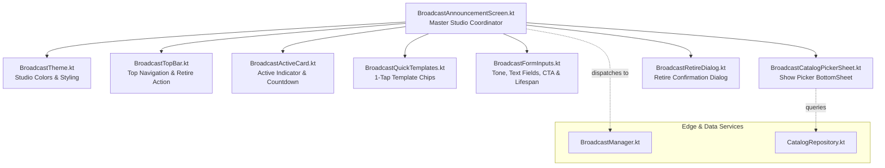

# StreamHub Broadcast Studio Architecture

Welcome to the **Broadcast Package** (`com.streamhub.app.ui.screens.broadcast`)!

This directory contains the administrative Broadcast Studio used to compose, test, and publish real-time global in-app announcements delivered through Cloudflare Edge Workers and KV storage (`/api/broadcasts/latest`).

---

## 🏗️ Architectural Overview

---

## 📂 File Directory

| File | Purpose |
| :--- | :--- |
| **`BroadcastTheme.kt`** | Defines the cinema-grade color palette: `BroadcastSurfaceDark`, `BroadcastPrimaryPurple`, `BroadcastEmeraldAccent`, `BroadcastSkyAccent`, `BroadcastAmberAccent`, and `BroadcastRoseAccent`. |
| **`BroadcastTopBar.kt`** | Studio top app bar with Back navigation, headline, and top Retire action button. |
| **`BroadcastActiveCard.kt`** | Displays the live pulsing emerald green indicator (`1 ACTIVE EDGE BROADCAST`), active title/message, expiration countdown, and "Edit In Studio" action. |
| **`BroadcastQuickTemplates.kt`** | Houses 1-Tap quick templates: `New Release` (Content tone + Watch CTA), `App Update` (Notice tone + Link CTA), and `Maintenance` (Urgent tone + 6h auto-decay). |
| **`BroadcastFormInputs.kt`** | Contains tone cards (Content / Notice / Urgent), title and message text fields with character limit counters, action type pills (None / Watch Show / Web Link), and lifespan auto-decay presets (1h, 6h, 12h, 24h, 3d, 7d). |
| **`BroadcastCatalogPickerSheet.kt`** | Bottom sheet with live search to pick any movie/series from the catalog for instant "Watch Now" CTAs. |
| **`BroadcastRetireDialog.kt`** | Safety confirmation dialog before wiping the active broadcast from Cloudflare Edge. |
| **`BroadcastAnnouncementScreen.kt`** | Master Coordinator composing all blocks, WYSIWYG preview banner, and sticky publish button. |

---

## 🛡️ Key Features & Invariants

1. **Zero-Poll Cloudflare Edge Architecture**:
   - Announcements operate strictly via passive `GET /api/broadcasts/latest` on app launch and foregrounding, protecting Cloudflare free-tier quotas.
2. **0ms WYSIWYG Banner Preview**:
   - The studio renders `InAppBroadcastBanner` inline, mirroring active inputs in real-time so administrators see the exact visual presentation users will receive before hitting Publish.
3. **Hardware & Ephemeral Lifespans**:
   - Every broadcast has an enforced TTL expiration (`expiresAt`), guaranteeing that temporary announcements automatically disappear without requiring manual developer intervention.
