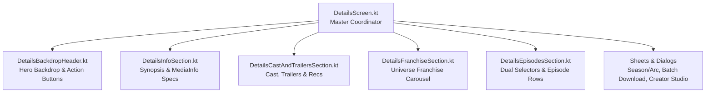

# 🎬 Details Screen Architecture (`ui/screens/details/`)

## 🌟 Overview & Purpose
The `details` package houses the entire Media Presentation & Catalog Explorer suite for StreamHub.
Whenever a user taps any poster from the Home Screen, Search, or Franchise Carousels, this screen displays the cinematic hero backdrop, technical MediaInfo specs, cast avatars, trailers, franchise universe connections, and interactive episode streaming/download lists.

---

## 📂 File Directory & Responsibility Breakdown

| File | Responsibility |
|---|---|
| `DetailsScreen.kt` | **Master Coordinator Composable**: Manages state (`mediaItem`, `selectedSeasonNumber`, `selectedArcName`, `downloads`), auto-scroll to current episode with glowing border timer, pre-warming coroutines, and 3-tab navigation. |
| `DetailsBackdropHeader.kt` | **Hero Section**: 16:9 Trailer Box with gradient overlay, glassmorphic Trailer Play Badge, poster box, title, ratings (AniList/IMDb), genre chips, and Play/Resume & My List action buttons. |
| `DetailsInfoSection.kt` | **Overview & Specs**: Technical MediaInfo specs chips, synopsis text, directors/creators, and the full `DetailsExtendedInfoTab` specification table. |
| `DetailsCastAndTrailersSection.kt` | **Cast, Trailers & Recs**: Voice actor & top cast carousel with character roles, YouTube trailer previews, and the `DetailsRecommendationsTab` recommendation grid. |
| `DetailsFranchiseSection.kt` | **Franchise Universe Carousel**: Displays chronological order, sequels, prequels, movies, and OVAs with watch order tags (`#1`, `S1`, `M1`) and completion badges. |
| `DetailsEpisodesSection.kt` | **Streaming & Episodes List**: `ExpressiveDualSelectorSplitButton` (Season/Arc switchers), batch download trigger, season watched toggle, and individual `EpisodeRowItem` cards with circular download buttons. |

---

## 🔒 Architectural & Invariant Guarantees
- **No Remote Frame Extraction**: Frame scrubbing is kept strictly to local files or pre-rendered thumbnails.
- **Speculative Episode Pre-Warming**: Prewarms initial container heads and cues for the target episode and season runway without blocking main threads.
- **Zero Confusion on Badges**: Respects `FranchiseManager.getPosterBadge(item)` and never conflates `franchiseOrder` with display badges.
- **R8 / ProGuard Stripping**: All explanatory comments and headers are completely stripped during release builds, ensuring zero byte bloat and maximum security.
