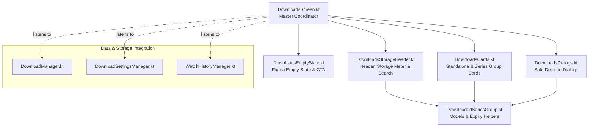

# StreamHub Offline Downloads Architecture

Welcome to the **Downloads Package** (`com.streamhub.app.ui.screens.downloads`)!

This directory contains the entire user interface and interaction lifecycle for offline media downloads in StreamHub. Every file in this package has a single, well-defined responsibility, ensuring clean code readability, zero UI regressions, and beginner-friendly maintainability.

---

## 🏗️ Architectural Overview

---

## 📂 File Directory

| File | Purpose |
| :--- | :--- |
| **`DownloadedSeriesGroup.kt`** | Data model representing a grouped series/movie and the `formatDownloadExpiryBadge` helper calculating TTL expiration days. |
| **`DownloadsStorageHeader.kt`** | Displays the top header, real device disk storage gauge (Internal Storage / SD Card), quick preference toggles, and the live search bar. |
| **`DownloadsCards.kt`** | Houses `DownloadedStandaloneCard` (for movies/single items), `DownloadedSeriesGroupCard` (multi-episode series accordion with batch selection), and `DownloadedEpisodeRowItem`. |
| **`DownloadsEmptyState.kt`** | Figma-exact vector illustration with a 14-degree rotated Play Badge, pulsing orbital dot, and asymmetric CTA button. |
| **`DownloadsDialogs.kt`** | Houses confirmation dialogs for single episode deletion, entire series deletion, and batch selection episode deletion. |
| **`DownloadsScreen.kt`** | Master Coordinator composable that binds StateFlows, orchestrates playlists, and displays the UI layout. |

---

## 🛡️ Key Features & Invariants

1. **Zero Duplicate Show Cards**:
   - Episodes belonging to the same `mediaId` are grouped into a single `DownloadedSeriesGroupCard`.
   - Single movies or standalone downloads render a streamlined `DownloadedStandaloneCard` without accordion clutter.
2. **Offline Binge Playlists**:
   - When a user taps Play on a series or an episode inside an accordion, an offline playlist is automatically constructed with `streamUrl = localFilePath`, allowing ExoPlayer to seamlessly auto-advance to subsequent downloaded episodes without an internet connection.
3. **Accurate Hardware Storage Meter**:
   - Uses `android.os.StatFs` to read actual hardware disk partition blocks and `ContextCompat.getExternalFilesDirs` to distinguish between Internal Storage and removable SD Cards.
4. **Haptic & Long-Press Watch Status**:
   - Long-pressing on any downloaded card or episode triggers haptic feedback and toggles its watched status in `WatchHistoryManager`.
