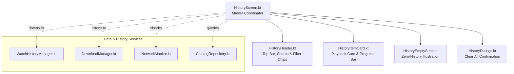

# StreamHub Watch History Architecture

Welcome to the **History Package** (`com.streamhub.app.ui.screens.history`)!

This directory governs chronological playback progress tracking, continue-watching resumption, and offline download fallback.

---

## 🏗️ Architectural Overview

---

## 📂 File Directory

| File | Purpose |
| :--- | :--- |
| **`HistoryHeader.kt`** | Houses `HistoryTopBar` (back button, title, item counter, search toggle, and clear button), `HistorySearchBar` (animated field), and `HistoryFilterChipsRow` ("All", "Movies", "Anime", "Series"). |
| **`HistoryItemCard.kt`** | Renders 114x72dp thumbnail, play overlay, horizontal progress bar (green if fully completed, red if in progress), `S1:E3` subtitle formatting, and dismiss button. |
| **`HistoryEmptyState.kt`** | Illustrated zero-state when history is empty or search queries match no watched titles. |
| **`HistoryDialogs.kt`** | Houses `ClearHistoryDialog` confirming before purging the watch history store. |
| **`HistoryScreen.kt`** | Master Coordinator composing all blocks, grouping history by date sections, managing undoable snackbars, and offline playback failover. |

---

## 🛡️ Key Features & Invariants

1. **Offline Playback Failover**:
   - If the user is offline (`!NetworkMonitor.isOnline`), tapping Resume Play automatically checks for downloaded offline copies of the target episode, ensuring uninterrupted playback even in airplane mode.
2. **Instant Undo Snackbar**:
   - Removing an item from history triggers a snackbar with an "Undo" action, letting the user immediately restore accidental dismissals without data loss.
3. **Chronological Section Grouping**:
   - Items are automatically clustered by timeframes ("Today", "Yesterday", "This Week", "Older") via `WatchHistoryManager.getGroupedHistory`.
