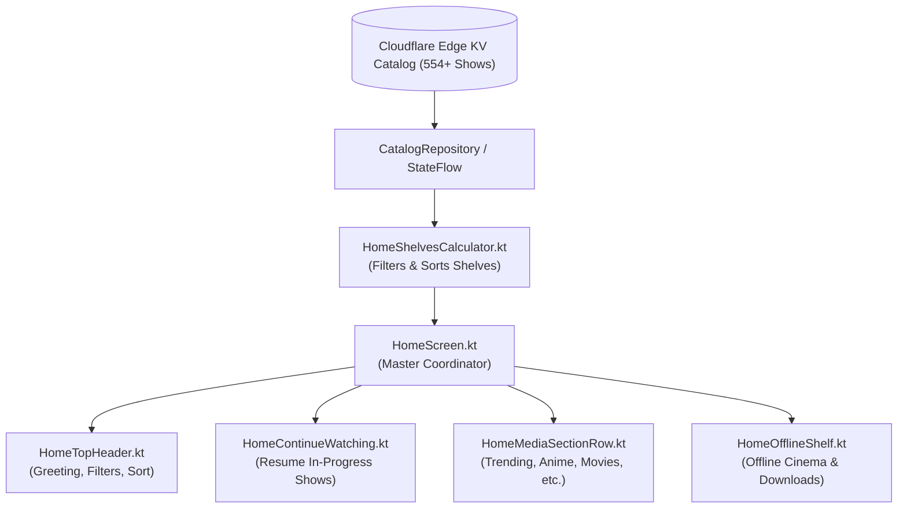

# 🏠 StreamHub Home Screen Architecture

> **Purpose:** This folder contains **only** the code required to build and run the StreamHub Home Screen. No other screens or unrelated features are here. Everything is modular, cleanly isolated, and beginner-friendly.

---

## 📂 Files in this Package

| File | What It Does (In Simple Words) | Lines |
|---|---|---|
| [`HomeScreen.kt`](HomeScreen.kt) | **The Master Coordinator**: Assembles the entire Home Screen. Coordinates pull-to-refresh, scrolling persistence, the FAB speed-dial, and renders the shelves in order. | ~770 |
| [`HomeShelvesCalculator.kt`](HomeShelvesCalculator.kt) | **The Shelf Brain**: Takes the raw 554+ shows from the database and sorts them into Featured, Continue Watching, "Because You Watched", Trending, and Category shelves. | ~265 |
| [`HomeTopHeader.kt`](HomeTopHeader.kt) | **Top Greeting & Category Rail**: Displays "Good Morning/Evening", the "Surprise Me" dice button, sort dropdown, and the fluid animated category filter pills (All, Anime, Movies, Series). | ~340 |
| [`HomeContinueWatching.kt`](HomeContinueWatching.kt) | **Continue Watching Showcase**: Displays titles you've started with progress bars, episode chips, fluid swipe-to-dismiss physics, and animated ripple play buttons. | ~375 |
| [`HomeMediaSectionRow.kt`](HomeMediaSectionRow.kt) | **Horizontal Shelf Row**: Renders a smoothly scrolling horizontal row of movie/anime posters with scroll position memory across screen navigation. | ~95 |
| [`HomeOfflineShelf.kt`](HomeOfflineShelf.kt) | **Offline Mode Cinema Hub**: Displays downloaded media cards when offline, or the special Offline Cinema banner on the home screen. | ~180 |

---

## 🧭 How Data Flows Through the Home Screen

---

## 🔒 Security & Performance Rules
1. **Zero Comment Leakage**: All comments in these files are stripped 100% by R8/ProGuard in release APKs.
2. **Zero Inversion**: Play/pause state is bound strictly to playback intent (`playWhenReady`).
3. **Scroll Position Memory**: Every horizontal shelf preserves its exact scroll offset via `HomeScreenScrollManager`.
