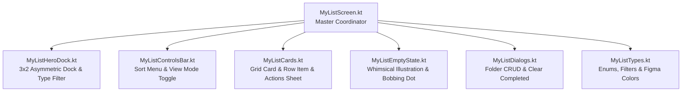

# 📌 My List & Watchlist Architecture (`ui/screens/mylist/`)

## 🌟 Overview & Purpose
The `mylist` package houses the entire personal library and watch progress tracking experience in StreamHub.
It lets users organize saved titles into custom collections, view real-time resume points, toggle favorites, sort by ratings/dates, and manage content in fluid grid or list views.

---

## 📂 File Directory & Responsibility Breakdown

| File | Responsibility |
|---|---|
| `MyListScreen.kt` | **Master Coordinator Composable**: Manages state flows (`catalog`, `myItemsMap`, `historyMap`, `collections`), filter predicates, sorting logic, and layout switching. |
| `MyListHeroDock.kt` | **Hero Section & Media Dock**: Top eyebrow headline, search toggle with instant field, 3×2 asymmetric dock (`All saved`, `Favorites`, `In progress`, `Watch later`, `Completed`, `Folders`), and fluid-viscosity segmented filter (`All types`, `Movies`, `TV & Anime`). |
| `MyListControlsBar.kt` | **Sorting & Controls**: Squircle "Recent ⌄" button with dropdown menu, bidirectional sorting (High to Low / Low to High), view mode toggle (Grid ⊞ ↔ List ☰), and dynamic genre filter chips. |
| `MyListCards.kt` | **Card & Item Presentation**: `MyListGridCard` (portrait 2:3 or landscape card with resume progress lines), `MyListRowItem` (detailed landscape row), and `MyListCardActionSheet` (quick actions on long-press). |
| `MyListEmptyState.kt` | **Whimsical Empty State**: Figma-exact vector illustration with 14-degree squircle plus badge and orbital bobbing coral dot with live radial bloom. |
| `MyListDialogs.kt` | **Folder & Collection Management**: Dialogs to create, rename, delete custom folders, add shows to folders, and clear completed titles. |
| `MyListTypes.kt` | **Constants & Models**: `MyListStatusCategory`, `MyListSortOption`, `MyListTypeFilter`, and Figma theme colors (`CreamyPeach`, `DarkCreamText`, `CoralAccent`). |

---

## 🔒 Architectural & Invariant Guarantees
- **Non-Destructive Folder Deletion**: Deleting a custom folder never deletes the saved media items; it safely moves them back to the default "Watchlist".
- **Zero Memory Leaks**: Animations (bobbing dot, progress pulses) use `rememberInfiniteTransition` scoped strictly to composable lifecycles.
- **R8 / ProGuard Stripping**: All explanatory comments and headers are completely stripped during release builds, ensuring zero byte bloat and maximum security.
