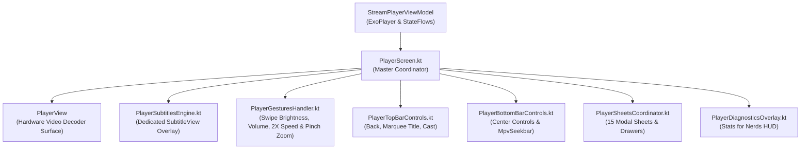

# 🎬 StreamHub Video Player Architecture

> **Purpose:** This folder contains **only** the code required to run the high-performance media playback engine and UI overlay. Everything is modular, cleanly isolated, and beginner-friendly.

---

## 📂 Core Player Files

| File | What It Does (In Simple Words) |
|---|---|
| [`PlayerScreen.kt`](PlayerScreen.kt) | **The Master Coordinator**: Manages window fullscreen, Android immersive mode, display cutouts, PiP mode transitions, and coordinates the playback subcomponents. |
| [`PlayerGesturesHandler.kt`](PlayerGesturesHandler.kt) | **Multi-Zone Touch Engine**: Left zone (brightness/volume & seek), Center zone (subtitle vertical position drag & play/pause), Right zone (volume boost & seek), and multi-touch pinch-to-zoom/pan. |
| [`PlayerSubtitlesEngine.kt`](PlayerSubtitlesEngine.kt) | **Universal Subtitle Engine**: Transforms PGS bitmap cues and ASS/SSA/SRT text cues, applies custom typography styles, and handles timing offsets and vertical positioning. |
| [`PlayerTopBarControls.kt`](PlayerTopBarControls.kt) | **Top HUD Bar**: Displays back button, animated marquee title, Cast device trigger, track buttons, and ambient aura presets. |
| [`PlayerBottomBarControls.kt`](PlayerBottomBarControls.kt) | **Bottom Controls & Scrubber**: Displays center skip/play/pause buttons, action row (lock, rotation, speed pill, aspect ratio, frame navigation capsule), and the high-precision `MpvSeekbar`. |
| [`PlayerDiagnosticsOverlay.kt`](PlayerDiagnosticsOverlay.kt) | **Stats for Nerds Diagnostics**: Displays live video codecs, dropped frames, buffer health, download speed, and JVM/system memory telemetry. |
| [`PlayerSheetsCoordinator.kt`](PlayerSheetsCoordinator.kt) | **Sheets & Dialogs Coordinator**: Coordinates all 15 modal bottom sheets (Audio/Subtitle tracks, Playback Speed, Aspect Ratio, Cast, Online Subtitle Search, etc.). |

---

## 🧭 How the Player Architecture Works

---

## 🔒 Inviolable Player Invariants
1. **Zero State Inversion**: Play/pause intent is strictly bound to `player.playWhenReady` (never transient `player.isPlaying` alone).
2. **Buffer Ceiling**: 256 MB hard-locked buffer ceiling with 12m–15m continuous charging runway.
3. **Bandwidth Priority**: Active playback retains 100% of network line bandwidth.
4. **Security & Performance**: All comments are 100% stripped by R8/ProGuard in release builds.
