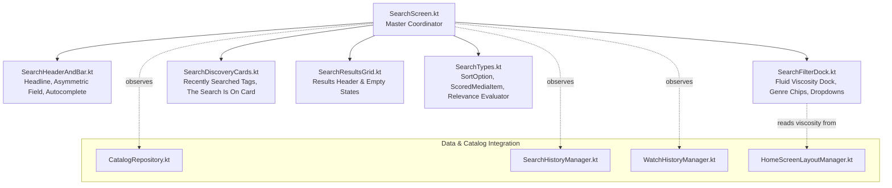

# StreamHub Search & Exploration Architecture

Welcome to the **Search Package** (`com.streamhub.app.ui.screens.search`)!

This directory governs the search intelligence, filtering systems, discovery widgets, and media grid for StreamHub. Every file in this package has a single, isolated responsibility, ensuring maintainability, readability, and zero UI regressions.

---

## 🏗️ Architectural Overview

---

## 📂 File Directory

| File | Purpose |
| :--- | :--- |
| **`SearchTypes.kt`** | Houses the `SortOption` enum, `ScoredMediaItem` data class, the multi-tier `SearchRelevanceEvaluator` token evaluation engine, and the `formatTrendingLabel` subtitle cleanup helper. |
| **`SearchHeaderAndBar.kt`** | Contains the `SearchHeaderBlock` (headline and active filter count badge), the asymmetrical 60dp `SearchInputField`, and the horizontal `SearchAutocompleteSuggestionsRow`. |
| **`SearchFilterDock.kt`** | Contains the fluid-viscosity `SearchCategorySegmentedDock` (All / Anime / Movies / Series) with spring physics, squircle `SearchGenreFilterChips`, 3-column `SearchDropdownFiltersRow` (Rating, Year, Sort), and one-touch `SearchQuickRatingsRow`. |
| **`SearchDiscoveryCards.kt`** | Contains `SearchRecentlySearchedSection` (removable query history chips with clear all action) and the 124dp lavender `SearchDynamicTrendingCard` ("The search is on." top 5 titles arranged in 3+2 columns). |
| **`SearchResultsGrid.kt`** | Houses `SearchResultsHeader` (title and total item counter) and `SearchResultsEmptyState` (with "Reset All Filters" CTA). |
| **`SearchScreen.kt`** | Master Coordinator composable tying StateFlows, debounced queries, the 3-column `LazyVerticalGrid`, `MediaCard`, `MediaQuickActionsSheet`, and `SnackbarHost`. |

---

## 🛡️ Key Features & Invariants

1. **Intelligent Token Relevance Engine (`SearchRelevanceEvaluator`)**:
   - Queries are evaluated against title, synonyms, season titles, franchise universes, studios, cast members, and genres with exact, prefix, token-count, and compactness weights.
2. **Debounced Query Execution (300ms)**:
   - User keystrokes are recorded immediately in `searchQuery` for 120fps UI responsiveness, while catalog filtering and sorting run on `debouncedQuery` with a 300ms delay to eliminate micro-stutters during rapid typing.
3. **Fluid Viscosity Segmented Dock**:
   - Seamlessly binds to `HomeScreenLayoutManager.layoutConfig.fluidViscosity` for spring-loaded asymmetric pill stretching and corner-radius morphing.
4. **Quick Action Context Sheets**:
   - Long-pressing any `MediaCard` in the search results summons `MediaQuickActionsSheet` with options to Play, Restart, Mark as Watched/Completed, or View Details with an undoable snackbar.
