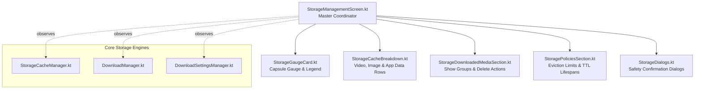

# StreamHub Storage & Cache Architecture

Welcome to the **Storage Package** (`com.streamhub.app.ui.screens.storage`)!

This directory manages disk cache consumption, progressive ExoPlayer stream buffer eviction, Coil image/poster caching, and offline download storage.

---

## 🏗️ Architectural Overview

---

## 📂 File Directory

| File | Purpose |
| :--- | :--- |
| **`StorageGaugeCard.kt`** | Multi-colored capsule storage gauge and `StorageLegendItem` displaying exact formatted byte counts across video, images, metadata, and offline downloads. |
| **`StorageCacheBreakdown.kt`** | Granular cache rows (`CacheActionRow`), Video Buffer, Poster Thumbnails, App Data, and Offline Downloads rows, paired with the master "Clear All Cache" action button. |
| **`StorageDownloadedMediaSection.kt`** | `ShowDownloadGroup` data class, per-show download rows with poster art, ready episode counts, total MBs, and single-show delete buttons. |
| **`StoragePoliciesSection.kt`** | `DropdownSettingRow` generic selector, Cache Size Limit, Cache TTL, Downloads TTL, and the "Instant Resume Cache" switch. |
| **`StorageDialogs.kt`** | `ClearAllCacheDialog`, `DeleteShowDownloadsDialog`, and `DeleteAllDownloadsDialog`. |
| **`StorageManagementScreen.kt`** | Master Coordinator composing top bar, gauge, cache rows, show list, policies, dialogs, and `CachedStreamsSheet`. |

---

## 🛡️ Key Features & Invariants

1. **Non-Destructive Storage Calculations**:
   - Cache measurements run asynchronously on `Dispatchers.IO` via `StorageCacheManager.calculateStorageUsage()`, avoiding main-thread disk walks.
2. **Safe Multi-Tier Eviction**:
   - Clearing app cache purges temporary video segments and image thumbnails without touching user preferences, watch history, or offline downloads.
3. **ExoPlayer Cache Lock Safeguard**:
   - When ExoPlayer is actively streaming or reading a media cache lock, `StorageCacheManager.clearVideoCache()` gracefully defers eviction until playback ends to prevent playback crashes.
